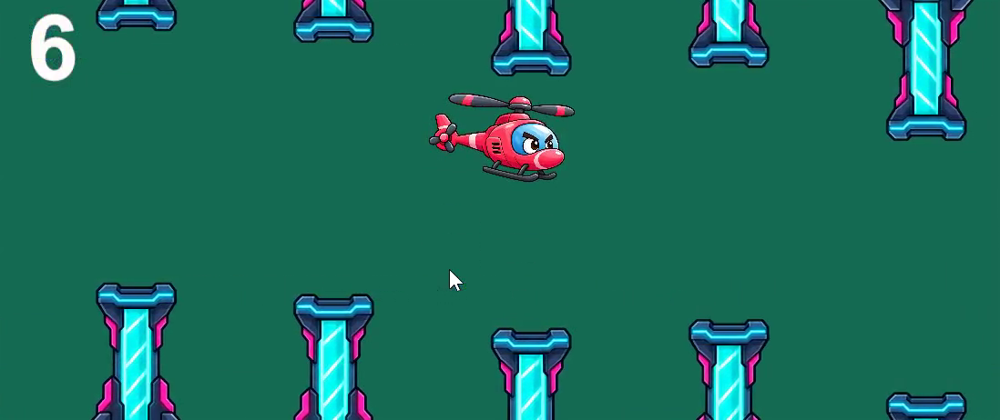
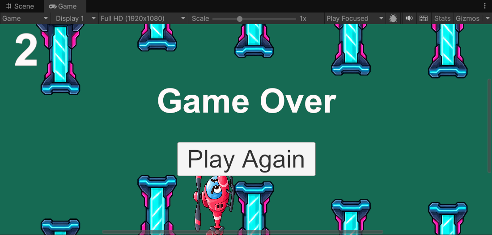

# Chopper Hopper 🚁

A 2D arcade game developed in Unity using C#.

## About
Chopper Hopper is a Flappy Bird-inspired game featuring a helicopter, futuristic neon obstacles, and score-based gameplay.

## Features
- Helicopter movement and player input
- Procedurally spawned obstacle pairs
- Collision and game-over detection
- Score tracking
- Increasing difficulty *(planned)*

## Tech Stack
- Unity
- C#
- Git and GitHub

## How to Run
1. Clone or download this repository.
2. Open the project folder using Unity Hub.
3. Open the main game scene from `Assets/Scenes`.
4. Press Play.

## Screenshots

## Gameplay

## Game Over

## Gameplay Demo

[Watch Chopper Hopper gameplay]([https://www.youtube.com/watch?v=YOUR_VIDEO_ID](https://youtu.be/KTdaK0qzVV8))
      

## Future Improvements
- Start and restart menus
- Sound effects and background music
- High-score persistence
- Windows build

## Author
Mrunal Kumbhare
